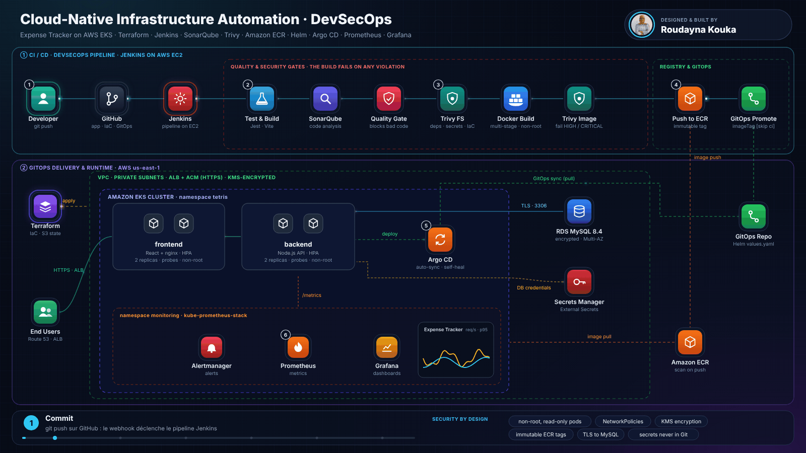
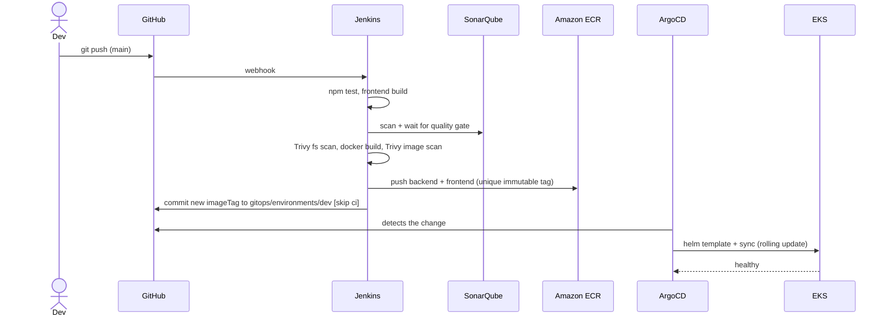

# Secure-Cloud-Native-DevSecOps-Platform

> A production-style, end-to-end DevOps platform: a **React + Node.js + MySQL** three-tier application deployed on **AWS EKS** with **Terraform** (IaC), **Jenkins** (CI) with **SonarQube** and **Trivy** (quality & security gates), **Helm** packaging, **ArgoCD** (GitOps CD) and **Prometheus + Grafana** (observability).

**Author & maintainer: [Roudayna Kouka](https://github.com/roudayn-kouka)** — Software Engineering student, DevOps/Cloud & Cybersecurity.

---

## Table of contents
1. [Architecture](#architecture)
2. [Tech stack](#tech-stack)
3. [Repository layout](#repository-layout)
4. [Run it locally (5 minutes)](#run-it-locally)
5. [Deploy to AWS](#deploy-to-aws)
6. [CI/CD and GitOps flow](#cicd-and-gitops-flow)
7. [Observability](#observability)
8. [Security](#security)
9. [API reference](#api-reference)
10. [Cost and teardown](#cost-and-teardown)
11. [Roadmap](#roadmap)
12. [Acknowledgements & license](#acknowledgements--license)

---

## Architecture
The following animated architecture illustrates the end-to-end cloud-native infrastructure, from AWS resource provisioning and application delivery to automated security checks, GitOps deployment, and real-time observability.

<p align="center">
  
</p>

**Traffic flow:** `https://expense-dev.<your-domain>` → Route 53 alias → ALB (TLS terminated, HTTP→HTTPS redirect) → frontend pods (registered in the ALB target group by the AWS Load Balancer Controller through a `TargetGroupBinding`) → nginx proxies `/api/*` to the backend `ClusterIP` service → RDS in isolated database subnets.

See [`docs/architecture.md`](docs/architecture.md) for the CI/CD and GitOps sequence diagrams and design decisions.

## Tech stack

| Layer | Technology |
|-------|-----------|
| Application | React 18 (Vite), Node.js 22 / Express, MySQL 8.4 |
| Containers | Docker multi-stage builds, non-root, nginx-unprivileged, Amazon ECR (immutable tags, scan on push, lifecycle policy) |
| Infrastructure as Code | Terraform ≥ 1.10 — VPC, security groups, bastion, RDS, EKS, ACM, ALB, ECR, IAM (IRSA), remote state on S3 with native locking |
| Orchestration | Amazon EKS, Helm chart (HPA, PodDisruptionBudget, NetworkPolicy, probes, TargetGroupBinding) |
| CI | Jenkins (declarative pipeline), SonarQube quality gate, Trivy (fs / config / image), optional Nexus; GitHub Actions for PR validation |
| CD (GitOps) | ArgoCD, app-of-apps pattern, automated sync + self-heal |
| Observability | kube-prometheus-stack (Prometheus, Alertmanager, Grafana), ServiceMonitor, PrometheusRule alerts, provisioned Grafana dashboard |
| Secrets | AWS Secrets Manager → Kubernetes Secret (no credentials in Git) |

## Repository layout

```
.
├── backend/                 Node.js API (src/, tests/, schema/, Dockerfile)
├── frontend/                React app (Vite) + nginx config + Dockerfile
├── helm/expense/            Helm chart for the application (+ Grafana dashboard JSON)
├── gitops/
│   ├── argocd/              AppProject, root app, apps/{expense,monitoring}.yaml
│   ├── environments/dev/    values.yaml — updated by Jenkins on every release
│   └── platform/            Cluster-level manifests (gp3 StorageClass)
├── monitoring/              kube-prometheus-stack values + local Prometheus/Grafana config
├── terraform/               00-bootstrap, 00-vpc … 70-ecr (one state per stack)
├── jenkins/                 Server/agent setup scripts, plugin list, agent IAM policy
├── scripts/                 tf.sh, bootstrap-cluster.sh, init-db.sh, create-db-secret.sh
├── docs/                    Architecture, runbook, list of improvements
├── Jenkinsfile              CI/CD pipeline
├── docker-compose.yml       Local stack (+ optional Prometheus/Grafana profile)
└── sonar-project.properties
```

## Run it locally

Prerequisites: Docker with Compose v2.

```bash
cp .env.example .env            # choose your own passwords
docker compose up --build       # MySQL + API + React app
# App:  http://localhost:3000     API: http://localhost:8080/health

docker compose --profile observability up --build   # + Prometheus :9090 and Grafana :3001
```

Without Docker (Node 20+ and a MySQL instance):

```bash
cd backend  && npm ci && npm test && DB_HOST=127.0.0.1 DB_PWD=... npm start
cd frontend && npm ci && npm run dev      # http://localhost:5173, /api is proxied to :8080
```

## Deploy to AWS

> Prerequisites: AWS account and credentials, Terraform ≥ 1.10, a **public Route 53 hosted zone** you own, a GitHub repository (fork this one) and ~2 hours. Details for every stack are in [`terraform/README.md`](terraform/README.md).

1. **State bucket (once)** — `cd terraform/00-bootstrap && terraform init && terraform apply -var state_bucket_name=<unique-name>`; then `cp terraform/backend.hcl.example terraform/backend.hcl` and set the bucket.
2. **Infrastructure** — `export TF_VAR_zone_name=example.com` (and optionally `TF_VAR_bastion_allowed_cidrs='["<your-ip>/32"]'`), then `./scripts/tf.sh apply` (VPC → SG → bastion → RDS → EKS → ACM → ALB → ECR).
3. **Initialise the database** — open a session on the bastion (`aws ssm start-session --target <bastion_instance_id>`), clone the repo and run `./scripts/init-db.sh` (creates the least-privilege `expense` user).
4. **Bootstrap the cluster** — on the bastion run `./scripts/bootstrap-cluster.sh`. It installs metrics-server, the AWS Load Balancer Controller, the namespaces/secrets, ArgoCD and the root application.
5. **Configure the environment** — edit `gitops/environments/dev/values.yaml` (`imageRegistry`, `dbHost` = `terraform output db_endpoint`, `targetGroupARN` = `terraform output frontend_target_group_arn`) and, if your fork has another name, the `repoURL` in `gitops/argocd/*.yaml`. Commit and push.
6. **Set up Jenkins + SonarQube** — follow [`jenkins/README.md`](jenkins/README.md), create the multibranch job and push to `main`.
7. Jenkins builds, scans and pushes the images and commits the new tag → **ArgoCD deploys** → open `https://expense-dev.<your-domain>`.

## CI/CD and GitOps flow



* Jenkins **never has cluster credentials** — Git is the single source of truth and ArgoCD pulls changes (self-heal reverts manual drift).
* Image tags are `<version>-<build>-<git-sha>`; ECR tags are immutable, so every deployment is traceable and rollbacks are a `git revert`.
* Branch builds run every quality and security gate but never push or deploy.

## Observability

* The API exposes Prometheus metrics at `/metrics`: request count and latency histogram per route, DB availability gauge and Node.js runtime metrics.
* A `ServiceMonitor` registers the backend with Prometheus; a `PrometheusRule` defines alerts (backend down, 5xx ratio > 5 %, p95 latency > 1 s, database unreachable, crash-looping pods).
* A Grafana dashboard (*Expense Tracker – Application*) is provisioned automatically from a ConfigMap. Locally, the `observability` Compose profile loads the same dashboard.
* Access (no public exposure by default): `kubectl -n monitoring port-forward svc/kube-prometheus-stack-grafana 3000:80`.

## Security

| Area | Measure |
|------|---------|
| Network | Private subnets for EKS, isolated DB subnets, security groups referencing each other, bastion without inbound SSH by default (SSM Session Manager), Kubernetes NetworkPolicies (default-deny + explicit allows) |
| Secrets | DB passwords generated by Terraform and kept in Secrets Manager; Kubernetes Secret created from it; nothing sensitive in Git |
| Identity | IRSA roles for the Load Balancer Controller and EBS CSI driver (no broad node policies), IMDSv2 only, EKS access entries |
| Containers | Multi-stage builds, non-root users, read-only root FS (backend), dropped capabilities, `seccomp: RuntimeDefault`, Pod Security Admission labels |
| Application | Parameterised SQL (no injection), input validation, Helmet headers, rate limiting, CORS configuration, body size limits, no stack traces in responses |
| Supply chain | SonarQube quality gate, Trivy (dependencies, secrets, IaC, images), ECR scan-on-push, immutable tags, Dependabot |
| Data | RDS encrypted at rest, private, automated backups; S3 state bucket versioned, encrypted and TLS-only; TLS 1.3 policy on the ALB |

## API reference

| Method & path | Description |
|---------------|-------------|
| `GET /health` | Liveness probe |
| `GET /ready` | Readiness probe (checks the database) |
| `GET /metrics` | Prometheus metrics |
| `GET /transaction` | List expenses → `{ "result": [{ id, amount, description }] }` |
| `POST /transaction` | Create: body `{ "amount": 25, "desc": "Groceries" }` → `201` |
| `GET /transaction/:id` | Fetch one (`404` if missing) |
| `DELETE /transaction/:id` | Delete one |
| `DELETE /transaction` | Delete all |

## Cost and teardown

Approximate dev cost is dominated by the EKS control plane, the NAT gateway, two `m*.large` Spot nodes, RDS `db.t3.micro` and the ALB — **destroy the environment when you are not using it**:

```bash
# 1. remove the workloads first so the ALB/target groups/volumes are released
kubectl -n argocd delete application root --wait
# 2. then the infrastructure, in reverse order
./scripts/tf.sh destroy
```

Check the [EKS version support calendar](https://docs.aws.amazon.com/eks/latest/userguide/kubernetes-versions.html) before deploying: clusters on a version past standard support are billed at a higher rate.

## Roadmap

* External Secrets Operator instead of the one-off `create-db-secret.sh`
* Multi-environment promotion (staging → prod) with Argo CD ApplicationSets
* Cosign image signing and admission policy (Kyverno)
* OpenTelemetry tracing and Loki for logs
* Remote-state backed Terraform plans in CI (OIDC to AWS)

## Acknowledgements & license

This project started from the open-source *Cloud-Native DevOps Project* by [NotHarshhaa](https://github.com/NotHarshhaa) (MIT). It was substantially redesigned and extended by **Roudayna Kouka**: new React front-end, hardened and tested API, rewritten Terraform, Helm chart, GitOps with ArgoCD, observability stack, security scanning and documentation. See [`docs/IMPROVEMENTS.md`](docs/IMPROVEMENTS.md) for the full list of changes.

Released under the [MIT License](LICENSE) (the original copyright notice is preserved as the license requires).
